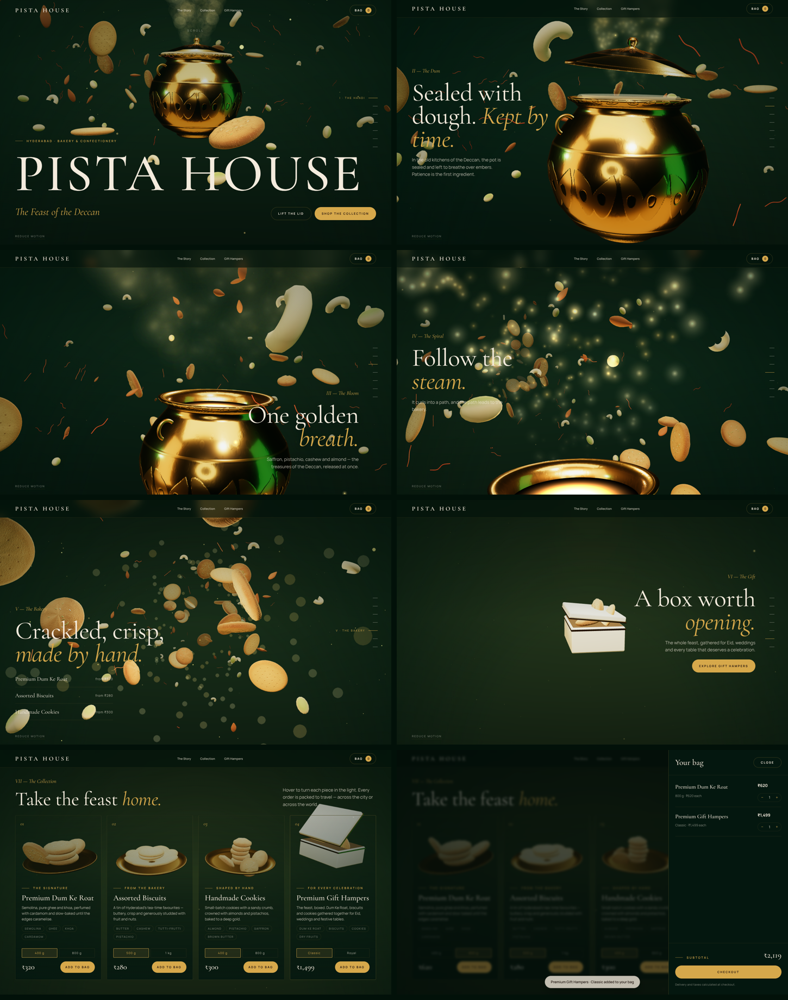

# Pista House: The Feast of the Deccan

An immersive, scroll-driven 3D homepage. A single continuous WebGL world (one
camera, one set of objects) is choreographed by one GSAP ScrollTrigger. The
shopping UI is ordinary, accessible DOM and stays usable at every point in the
film.



```bash
npm install
npm run dev     # http://localhost:3000
npm run build && npm start
```

## The film

| Beat | Progress | What happens |
| --- | --- | --- |
| I · The Handi | 0.00–0.12 | The camera approaches a floating antique brass handi with nuts, saffron and bakes in orbit |
| II · The Dum | 0.12–0.26 | The dough seal breaks and the lid rises; the biryani glow and steam spill out |
| III · The Bloom | 0.26–0.40 | A slow-motion burst of golden steam, pistachios, cashews and almonds |
| IV · The Spiral | 0.40–0.52 | The same steam and ingredients wind into a swirling tunnel |
| V · The Bakery | 0.52–0.76 | The camera flies through Dum Ke Roat, biscuits and cookies |
| VI · The Gift | 0.76–0.89 | A presentation box rises under a light shaft and opens |
| VII · The Collection | 0.89–1.00 | The box and three products fly down into their product cards |

The beat boundaries live in `src/lib/story.ts`. The camera path, the 3D props
and the DOM copy all read that one timeline. Objects are never swapped between
sections: each nut, saffron strand and bake blends through its own orbit, burst
and tunnel states.

### Keeping 3D products on their cards

Each product card has a transparent "stage". Every frame,
`Collection.tsx → slotToWorld` projects the stage's screen rectangle onto the
collection plane, as seen from the final camera pose. This keeps the 3D product
inside its card on any screen width and grid layout, and moves it with the card
as the page scrolls. Hovering or moving the pointer over a card lifts, spins
and tilts its product and moves a warm accent light onto it.

## Stack

Next.js 15 (App Router) · React 19 · React Three Fiber 9 · drei · three.js ·
@react-three/postprocessing (bloom, vignette, grain, ACES) · GSAP ScrollTrigger ·
Framer Motion (nav, loader, cards, bag drawer, toasts) · Zustand.

```
src/
  app/                 layout, page, global styles
  lib/                 story timeline, products, store, brand asset slots
  components/three/    Scene, CameraRig, Handi, Ingredients, BakedSwarm,
                       Particles (steam, dust), Atmosphere (sky, light shafts),
                       Displays + Collection (product reveal & universe)
  components/ui/       Experience shell, Story (GSAP), Shop (cards, bag), chrome
```

## Performance and fallbacks

- The world is built from instanced meshes and shader point clouds. There are
  no runtime downloads: textures are generated on canvases and the reflections
  come from an environment built out of Lightformers.
- Quality tiers: phones, touch devices and low-core machines get fewer
  particles, a lower DPR and no post-processing. `PerformanceMonitor` lowers
  the DPR and turns off effects if the frame rate drops.
- Portrait screens get a wider lens and a re-framed opening.
- Without WebGL, or with `prefers-reduced-motion`, the page shows a static art
  direction with the same copy, collection and bag. A "Play the 3D film" or
  "Reduce motion" toggle lets the visitor override this, and the choice is
  remembered.
- The bag persists in `localStorage`.

## Brand assets: required before launch

No official Pista House packaging was available while building this, so
**none was invented**:

- The nav uses the official logo (`public/brand/logo.svg`, copied unchanged
  from the `pista-house` repo's `assets/logo-polished-mark.svg`).
- The gift box is an **unbranded** ivory presentation box.

To add the real assets, put the files in `public/brand/` and set the paths in
`src/lib/brand.ts`:

```ts
logo: 'brand/logo.svg',
packaging: { hamper: '/brand/hamper-front.jpg', ... },
```

The packaging artwork is mapped onto the box face as supplied, with no changes.

### Blender GLB models

The handi, bakes and props are modelled procedurally (lathe profiles plus
procedural bake and engraving textures), so the page works with no extra
files. To swap in Blender exports, put the `.glb` files in `public/models/`
(Draco or meshopt compressed, about 1.5 MB or less each) and set
`BRAND_ASSETS.models.*`. For example, `handi: '/models/handi.glb'` replaces
the procedural pot. Model with the pot's base at y ≈ −1.45 and its rim at
y ≈ 1.6. Leave the lid as a separate object, because the scene animates it.

### Prices

The prices and pack sizes in `src/lib/products.ts` are **placeholders**.
Connect them to the live catalogue before launch. The bag's Checkout button is
an integration point and shows a notice for now. Only the homepage is built.
